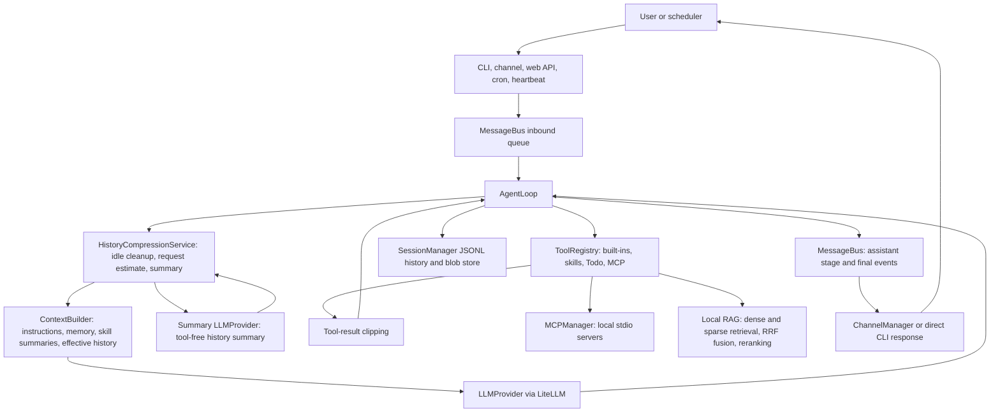

# Architecture
<!-- architecture-baseline: 5c85b417b42ea87e122de39121a7d011f609f8be -->

## Purpose

nanobot is a lightweight personal AI assistant framework. It accepts user turns from CLI, browser, scheduled tasks, heartbeat checks, and chat integrations; builds an agent context from workspace instructions, memory, skill summaries, and session history; calls an LLM through a provider abstraction; executes tools; and routes responses back to the originating channel.

## Tech Stack

| Technology | Architectural role |
| --- | --- |
| Python | Core runtime, CLI, agent loop, channels, persistence, and services. |
| Typer | CLI command surface and runtime composition. |
| Pydantic / pydantic-settings | Typed configuration model and environment binding. |
| LiteLLM | Unified chat-completion provider adapter. |
| FlagEmbedding / ChromaDB / SQLite | Dense and sparse embeddings, persistent hybrid retrieval indexes, and model reranking for RAG. |
| FastAPI / Uvicorn | Browser-facing web channel with HTTP APIs and WebSocket chat. |
| MCP Python SDK | Local stdio tool-server connections and discovery. |
| asyncio | Message bus, channel listeners, agent loop, cron timers, and heartbeat. |
| Next.js / React | Browser chat client under `web/`. |
| Node.js / WebSocket / Baileys | WhatsApp bridge under `bridge/`. |

## Directory Map

| Path | Responsibility |
| --- | --- |
| `nanobot/cli/` | CLI entry points and top-level runtime assembly. |
| `nanobot/harness/` | Agent runtime: loop, context, memory, skills, tools, subagents, attachments, history compression, and session persistence. |
| `nanobot/bus/` | Inbound and outbound message event types plus async queues. |
| `nanobot/channels/` | Chat channel adapters that translate platform events to and from bus messages. |
| `nanobot/webservice/` | Browser-client use cases for sessions, messages, attachments, and DTOs. |
| `nanobot/harness/session/` | Canonical conversation history, JSONL persistence, and stable blob storage. |
| `nanobot/providers/` | LLM provider interface, LiteLLM adapter, and provider metadata registry. |
| `nanobot/rag/` | Local knowledge-base ingestion, chunking, embedding, indexing, and retrieval. |
| `nanobot/mcp/` | Local MCP server lifecycle, discovery, calls, and result normalization. |
| `nanobot/utils/_debug.py`, `devtools/` | Optional main-agent context snapshots and a standalone local viewer. |
| `nanobot/config/` | Pydantic config schema, loading, migration, and key conversion. |
| `nanobot/cron/` | Scheduled agent-turn storage, timers, and execution callbacks. |
| `nanobot/heartbeat/` | Periodic workspace wake-up service. |
| `nanobot/skills/` | Bundled markdown skills loaded into agent context progressively. |
| `web/` | Browser chat UI and client-side API/WebSocket adapters. |
| `bridge/` | Local WhatsApp Web bridge process used by the Python WhatsApp channel. |
| `tests/` | Python behavior tests for backend contracts. |

## Main Flow

- CLI direct mode calls `AgentLoop.process_direct()` and returns text without channel dispatch.
- Gateway mode wires `MessageBus`, `AgentLoop`, `ChannelManager`, `CronService`, and `HeartbeatService`.
- Channel adapters own platform I/O; `AgentLoop` owns reasoning, tool execution, and session updates.

## Core Modules

### CLI Runtime
- Responsibility: load config, construct providers and services, and expose direct agent, gateway, status, channel, and cron commands.
- Key entry: `nanobot/cli/commands.py`; module entry: `nanobot/__main__.py`.
- Relationship: CLI is the composition root. It wires history compression and a summary provider, reusing the main provider unless a separate summary model is configured.

### Agent Harness
- Responsibility: process one user turn through request-time history compression, context building, LLM calls, tool execution, clipped-result persistence, and stage/final response creation.
- Key entries: `nanobot/harness/loop.py`, `nanobot/harness/compress/`, `nanobot/harness/status.py`.
- Relationship: `nanobot/harness/` groups agent execution and session persistence; the loop depends on `MessageBus`, `LLMProvider`, `SessionManager`, `ContextBuilder`, and `ToolRegistry`. A per-turn tool registry adds session-bound Todo editing; status snapshots carry elapsed time and current Todos into model context.
- `nanobot/harness/compress/service.py` owns main-agent request preparation: idle-triggered cleanup of old tool results/reasoning, character-based estimation of messages and tool schemas, and threshold-triggered summaries. Summaries retain the current user turn and complete tool-call/result groups; failed summaries leave the existing projection usable.

### Context, Memory, And Skills
- Responsibility: assemble code-owned instructions, runtime context, workspace `AGENTS.md`, long-term memory, and skill name/description summaries.
- Key entries: `nanobot/harness/context.py`, `nanobot/harness/prompts.py`, `nanobot/harness/memory.py`, `nanobot/harness/skills.py`.
- Relationship: workspace skills override bundled names; `load_skill` returns bodies and dependency diagnostics into tool history. `MemoryStore` only reads `memory/MEMORY.md`; automatic memory consolidation is absent. Context places a persisted history summary after the system prompt and before effective history as a marked user-role background message.

### Tools And Subagents
- Responsibility: provide OpenAI-style tool schemas and execute file writes/edits, PowerShell execution, web, RAG, skills, Todo, messaging, spawning, and scheduling.
- Key entries: `nanobot/harness/tools/`, `nanobot/harness/subagent.py`.
- Relationship: `ToolRegistry` is the execution boundary. Both loops share skill loading, RAG, and result clipping; reads/listings use the shell tool. Subagents have no history cleanup/summarization, session Todo/status, MCP registration, direct messaging, or nested spawning.

### Local MCP
- Responsibility: start configured local Python servers over stdio, discover tools asynchronously, execute calls, and close connections at runtime shutdown.
- Key entries: `nanobot/mcp/manager.py`, `nanobot/mcp/results.py`, `nanobot/harness/tools/mcp.py`.
- Relationship: CLI owns `MCPManager` and registers discovered adapters on the main agent. Each turn snapshots available tools; adapters project normalized text/structured results into tool strings. Server scripts must resolve inside the project root.

### Local RAG
- Responsibility: rebuild a local knowledge base from Markdown/text sources and retrieve snippets through dense and sparse search, weighted reciprocal-rank fusion, and model reranking.
- Key entries: `nanobot/rag/service.py`, `nanobot/rag/indexing.py`, `nanobot/rag/embeddings.py`, `nanobot/rag/store.py`, `nanobot/rag/rerank.py`, `nanobot/harness/tools/rag.py`.
- Relationship: the CLI triggers index initialization; the agent tool adapts synchronous retrieval into `ToolRegistry`. `service.py` orchestrates indexing and queries, while the neighboring modules own chunking, model lifecycle, dense Chroma storage, sparse SQLite storage, fusion, and reranking.

### Message Bus
- Responsibility: decouple inbound channel events from agent processing and outbound responses from platform delivery.
- Key entries: `nanobot/bus/events.py`, `nanobot/bus/queue.py`.
- Relationship: channels publish and consume bus events; the agent consumes inbound events and publishes outbound events.

### Channels
- Responsibility: adapt external chat platforms and the browser channel to the bus contract.
- Key entries: `nanobot/channels/base.py`, `nanobot/channels/manager.py`, `nanobot/channels/*.py`.
- Relationship: `BaseChannel` handles common allow-list checks and message normalization. `ChannelManager` initializes enabled channels and filters outbound event kinds; the web channel accepts stage and final events, while other channels normally receive only final replies and ordinary messages.

### Web Channel And Web Service
- Responsibility: expose browser chat over FastAPI HTTP endpoints and WebSocket, and implement web-specific session and attachment use cases.
- Key entries: `nanobot/channels/web.py`, `nanobot/webservice/service.py`, `nanobot/webservice/serialization.py`, `nanobot/webservice/attachments.py`.
- Relationship: the FastAPI channel is transport; `WebService` owns browser-facing business rules and delegates persistence to `SessionManager` and `WebAttachmentStore`. HTTP history and WebSocket events share message serializers and stable IDs; tool/system records and status snapshots stay out of browser DTOs.

### Sessions And Attachments
- Responsibility: store canonical role-based history, project it for providers, and keep attachment blobs stable across turns.
- Key entries: `nanobot/harness/session/manager.py`, `nanobot/harness/session/history.py`, `nanobot/harness/session/compression.py`, `nanobot/harness/session/blobs.py`, `nanobot/harness/attachments.py`.
- Relationship: `AgentLoop` appends canonical records with reasoning and raw tool-call arguments. Session compression projects effective records without rewriting canonical history; provider projection appends retained status snapshots. Web projection uses canonical history through `nanobot/webservice/serialization.py`. Legacy `_type` records are rejected.

### Providers
- Responsibility: hide provider-specific chat-completion behavior behind one async interface.
- Key entries: `nanobot/providers/base.py`, `nanobot/providers/litellm_provider.py`, `nanobot/providers/registry.py`.
- Relationship: provider matching, env setup, model prefixing, gateway/local detection, and parameter overrides belong in the registry and LiteLLM adapter, not in the agent loop. The adapter requests thinking output and preserves reasoning plus raw and parsed tool arguments.

### Cron And Heartbeat
- Responsibility: initiate agent turns without a live inbound user event.
- Key entries: `nanobot/cron/service.py`, `nanobot/cron/types.py`, `nanobot/heartbeat/service.py`.
- Relationship: cron persists jobs and invokes an agent callback; heartbeat reads `HEARTBEAT.md` from the workspace and invokes an agent callback only when actionable content exists.

### Browser Client
- Responsibility: render chat sessions, drafts, uploads, Markdown replies, and collapsible reasoning/tool calls.
- Key entries: `web/app/page.tsx`, `web/features/chat/components/ChatPage.tsx`, `web/features/chat/hooks/useChatController.ts`, `web/features/chat/services/`.
- Relationship: HTTP APIs manage status, sessions, pin/delete, and uploads; WebSocket sends turns with client message IDs and receives stage/final records. The client merges optimistic messages, live events, and loaded history by ID.

### WhatsApp Bridge
- Responsibility: isolate WhatsApp Web/Baileys concerns in a local Node process and expose a localhost WebSocket bridge for Python.
- Key entries: `bridge/src/index.ts`, `bridge/src/server.ts`, `bridge/src/whatsapp.ts`.
- Relationship: Python channels interact with the bridge protocol; WhatsApp auth and reconnect behavior stay in `bridge/`.

## Data & State

| State | Owner | Persistence |
| --- | --- | --- |
| Conversation sessions | `SessionManager` | JSONL files under `.nanobot/sessions`. |
| Session metadata and Todos | `SessionManager`; `TodoEditTool` replaces the Todo list | First metadata record in each session JSONL file. |
| History cleanup boundaries and summary | `HistoryCompressionService` proposes; `SessionManager` validates and atomically commits | Compression state in session JSONL metadata; canonical records remain intact. |
| Turn timer and status snapshots | Main-agent `AgentStatus` | Timer is in memory; immutable snapshots persist on user/system/tool records. |
| Long-term memory | Workspace file; `MemoryStore` reads it | Workspace `memory/MEMORY.md`. |
| Latest model-context snapshot | `nanobot/utils/_debug.py` | Optional overwrite-only `.nanobot/debug/context.json`; read by `devtools/llm_viewer.py`. |
| Stable image blobs for history | `SessionBlobStore` | `.nanobot/session_blobs`. |
| Browser upload attachments | `WebAttachmentStore` | `.nanobot/attachments/web` plus an attachment index. |
| RAG source documents | Repository-local RAG runtime | Externally populated `rag-test/source`. |
| RAG embedding and reranker models | `nanobot/rag/embeddings.py` and `nanobot/rag/rerank.py` | Downloaded on demand under `rag-test/model` and `rag-test/reranker-model`. |
| RAG dense and sparse indexes | `nanobot/rag/store.py` | Chroma under `rag-test/db/chroma` and SQLite under `rag-test/db/sqlite`. |
| Cron jobs and run state | `CronService` | `.nanobot/cron/jobs.json`. |
| Workspace bootstrap and user skills | Workspace | `.nanobot/workspace` by default. |
| WhatsApp bridge auth | Bridge process | User bridge auth directory. |

- `AgentLoop` owns turn history transitions; `WebService` owns browser-session metadata operations and attachment lifecycle before bus entry.
- Both agent loops clip tool bodies before model reuse; main-agent history stores the clipped body, with status appended separately during projection. Later history cleanup and summarization affect only the model-facing projection. `/new` clears history, compression state, and Todos.

## Configuration

- Configuration enters through `nanobot/config/loader.py`, which reads `.nanobot/config.json`, migrates legacy shapes, converts camelCase keys to Python snake_case, and validates into `Config`; `NANOBOT_` environment variables can bind into the settings model.
- Main categories are agent defaults (including history cleanup timing, retention, summary threshold/budgets, and optional summary model), provider credentials and endpoints, channel credentials and policies, gateway/web host settings, web search settings, shell timeout, workspace restriction, tool-result token budget, and local MCP servers.
- Provider selection is derived from the model name and configured provider keys, then refined by `nanobot/providers/registry.py`.
- Channel enablement is configuration-driven; disabled channel modules should not be initialized by `ChannelManager`.
- Local RAG asset paths, embedding and reranker models, chunking, dense/sparse retrieval and fusion weights, result counts, and device settings are module-level constants in `nanobot/rag/config.py`.
- CLI injects general tool settings and the tool-result budget into the main/subagent loops; MCP configuration selects local servers, while RAG reads its own module-level settings. The optional context publisher captures main-agent messages/tools/model before and after loop updates, not provider wire payloads.

## Architecture Boundaries

- Keep `nanobot/cli/` as composition code. Business rules belong in services, agent modules, providers, or channels.
- Channel adapters may translate platform payloads and enforce channel policy, but they should communicate with the agent only through `MessageBus` events.
- `AgentLoop` should remain platform-agnostic. Add channel-specific behavior to channels or service layers.
- Keep MCP protocol and process lifecycle inside `nanobot/mcp/`; adapters expose tools without transferring server ownership to agent loops.
- Preserve canonical session record shapes in `nanobot/harness/session/history.py` when changing persistence or UI projections.
- History compression is main-agent-only and runs before model requests, not in a background worker. Compression policy belongs in `nanobot/harness/compress/`; persistent boundaries and effective-history projection belong in `nanobot/harness/session/`. Summaries do not replace canonical browser history or long-term memory.
- Provider-specific model naming, env variables, gateway detection, and overrides belong in `nanobot/providers/registry.py` and `LiteLLMProvider`.
- Browser-specific workflows belong in `nanobot/webservice/` and `web/features/chat/`; do not push UI concerns into the agent loop.
- Attachment safety checks and stable blob handling should remain centralized in `nanobot/harness/attachments.py`, `nanobot/harness/session/blobs.py`, and `nanobot/webservice/attachments.py`.
- Keep RAG orchestration, indexing, model lifecycle, storage, fusion, and reranking in their dedicated `nanobot/rag/` modules; agent-facing code should access retrieval through the registered RAG tool rather than manipulating either index directly.
- Cron should schedule and invoke callbacks; agent behavior for scheduled turns should stay in `AgentLoop`.
- The WhatsApp bridge is a compatibility boundary between Python and WhatsApp Web. Avoid casual protocol or auth-storage changes without checking both `bridge/` and `nanobot/channels/whatsapp.py`.
- Workspace restriction guards file paths and shell commands; it is not a process sandbox and does not constrain MCP servers. Skill loading validates paths within its own discovery roots.
