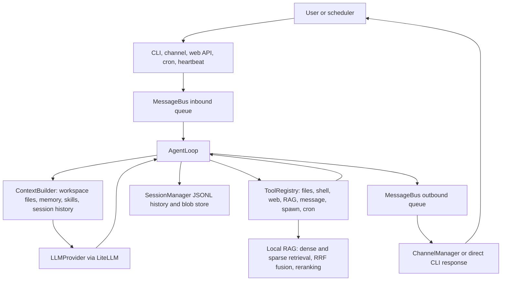

# Architecture
<!-- architecture-baseline: a69ece0bf09677b1107c3ca8d496d906cf5f0de9 -->

## Purpose

nanobot is a lightweight personal AI assistant framework. It accepts user turns from CLI, browser, scheduled tasks, heartbeat checks, and chat integrations; builds an agent context from workspace files, memory, skills, and session history; calls an LLM through a provider abstraction; executes tools; and routes responses back to the originating channel.

## Tech Stack

| Technology | Architectural role |
| --- | --- |
| Python | Core runtime, CLI, agent loop, channels, persistence, and services. |
| Typer | CLI command surface and runtime composition. |
| Pydantic / pydantic-settings | Typed configuration model and environment binding. |
| LiteLLM | Unified chat-completion provider adapter. |
| FlagEmbedding / ChromaDB / SQLite | Dense and sparse embeddings, persistent hybrid retrieval indexes, and model reranking for RAG. |
| FastAPI / Uvicorn | Browser-facing web channel with HTTP APIs and WebSocket chat. |
| asyncio | Message bus, channel listeners, agent loop, cron timers, and heartbeat. |
| Next.js / React | Browser chat client under `web/`. |
| Node.js / WebSocket / Baileys | WhatsApp bridge under `bridge/`. |

## Directory Map

| Path | Responsibility |
| --- | --- |
| `nanobot/cli/` | CLI entry points and top-level runtime assembly. |
| `nanobot/agent/` | Core agent loop, context construction, memory, skills, attachments, subagents, and built-in tools. |
| `nanobot/bus/` | Inbound and outbound message event types plus async queues. |
| `nanobot/channels/` | Chat channel adapters that translate platform events to and from bus messages. |
| `nanobot/webservice/` | Browser-client use cases for sessions, messages, attachments, and DTOs. |
| `nanobot/session/` | Canonical conversation history, JSONL persistence, and stable blob storage. |
| `nanobot/providers/` | LLM provider interface, LiteLLM adapter, and provider metadata registry. |
| `nanobot/rag/` | Local knowledge-base ingestion, chunking, embedding, indexing, and retrieval. |
| `nanobot/config/` | Pydantic config schema, loading, migration, and key conversion. |
| `nanobot/cron/` | Scheduled agent-turn storage, timers, and execution callbacks. |
| `nanobot/heartbeat/` | Periodic workspace wake-up service. |
| `nanobot/skills/` | Bundled markdown skills loaded into agent context progressively. |
| `web/` | Browser chat UI and client-side API/WebSocket adapters. |
| `bridge/` | Local WhatsApp Web bridge process used by the Python WhatsApp channel. |
| `tests/` | Python behavior tests mirroring backend modules. |

## Main Flow

- CLI direct mode calls `AgentLoop.process_direct()` and returns text without channel dispatch.
- Gateway mode wires `MessageBus`, `AgentLoop`, `ChannelManager`, `CronService`, and `HeartbeatService`.
- Channel adapters own platform I/O; `AgentLoop` owns reasoning, tool execution, and session updates.

## Core Modules

### CLI Runtime

- Responsibility: load config, construct providers and services, and expose direct agent, gateway, status, channel, and cron commands.
- Key entry: `nanobot/cli/commands.py`; module entry: `nanobot/__main__.py`.
- Relationship: CLI is the composition root. It should assemble modules, not duplicate agent, channel, or provider logic.

### Agent Core

- Responsibility: process one user turn through context building, LLM calls, tool execution, memory consolidation, and response creation.
- Key entry: `nanobot/agent/loop.py`.
- Relationship: depends on `MessageBus`, `LLMProvider`, `SessionManager`, `ContextBuilder`, and `ToolRegistry`. It should not contain platform-specific channel code.

### Context, Memory, And Skills

- Responsibility: build the system prompt from workspace bootstrap files, long-term memory, and skill metadata/content.
- Key entries: `nanobot/agent/context.py`, `nanobot/agent/memory.py`, `nanobot/agent/skills.py`.
- Relationship: workspace files and skills influence prompts, but session persistence remains in `nanobot/session/`.

### Tools And Subagents

- Responsibility: provide OpenAI-style tool schemas and execute filesystem, shell, web, message, spawn, and cron operations.
- Key entries: `nanobot/agent/tools/`, `nanobot/agent/subagent.py`.
- Relationship: `ToolRegistry` is the execution boundary. Main agents and subagents can invoke local RAG retrieval; subagents otherwise run focused loops without direct user messaging or nested spawning.

### Local RAG

- Responsibility: rebuild a local knowledge base from Markdown/text sources and retrieve snippets through dense and sparse search, weighted reciprocal-rank fusion, and model reranking.
- Key entries: `nanobot/rag/service.py`, `nanobot/rag/indexing.py`, `nanobot/rag/embeddings.py`, `nanobot/rag/store.py`, `nanobot/rag/rerank.py`, `nanobot/agent/tools/rag.py`.
- Relationship: the CLI triggers index initialization; the agent tool adapts synchronous retrieval into `ToolRegistry`. `service.py` orchestrates indexing and queries, while the neighboring modules own chunking, model lifecycle, dense Chroma storage, sparse SQLite storage, fusion, and reranking.

### Message Bus

- Responsibility: decouple inbound channel events from agent processing and outbound responses from platform delivery.
- Key entries: `nanobot/bus/events.py`, `nanobot/bus/queue.py`.
- Relationship: channels publish and consume bus events; the agent consumes inbound events and publishes outbound events.

### Channels

- Responsibility: adapt external chat platforms and the browser channel to the bus contract.
- Key entries: `nanobot/channels/base.py`, `nanobot/channels/manager.py`, `nanobot/channels/*.py`.
- Relationship: `BaseChannel` handles common allow-list checks and message normalization. `ChannelManager` initializes enabled channels and dispatches outbound messages.

### Web Channel And Web Service

- Responsibility: expose browser chat over FastAPI HTTP endpoints and WebSocket, and implement web-specific session and attachment use cases.
- Key entries: `nanobot/channels/web.py`, `nanobot/webservice/service.py`, `nanobot/webservice/attachments.py`.
- Relationship: the FastAPI channel is transport; `WebService` owns browser-facing business rules and delegates persistence to `SessionManager` and `WebAttachmentStore`.

### Sessions And Attachments

- Responsibility: store canonical history records, convert history for providers and UI, and keep attachment blobs stable across turns.
- Key entries: `nanobot/session/manager.py`, `nanobot/session/history.py`, `nanobot/session/blobs.py`, `nanobot/agent/attachments.py`.
- Relationship: `AgentLoop` appends canonical records; serializers project the same records into LLM and web-client shapes.

### Providers

- Responsibility: hide provider-specific chat-completion behavior behind one async interface.
- Key entries: `nanobot/providers/base.py`, `nanobot/providers/litellm_provider.py`, `nanobot/providers/registry.py`.
- Relationship: provider matching, env setup, model prefixing, gateway/local detection, and parameter overrides belong in the registry and LiteLLM adapter, not in the agent loop.

### Cron And Heartbeat

- Responsibility: initiate agent turns without a live inbound user event.
- Key entries: `nanobot/cron/service.py`, `nanobot/cron/types.py`, `nanobot/heartbeat/service.py`.
- Relationship: cron persists jobs and invokes an agent callback; heartbeat reads `HEARTBEAT.md` from the workspace and invokes an agent callback only when actionable content exists.

### Browser Client

- Responsibility: render chat sessions, drafts, uploads, connection state, and local optimistic UI.
- Key entries: `web/app/page.tsx`, `web/features/chat/components/ChatPage.tsx`, `web/features/chat/hooks/useChatController.ts`, `web/features/chat/services/`.
- Relationship: HTTP APIs manage status, sessions, pin/delete, and uploads; WebSocket sends turns and receives assistant replies.

### WhatsApp Bridge

- Responsibility: isolate WhatsApp Web/Baileys concerns in a local Node process and expose a localhost WebSocket bridge for Python.
- Key entries: `bridge/src/index.ts`, `bridge/src/server.ts`, `bridge/src/whatsapp.ts`.
- Relationship: Python channels interact with the bridge protocol; WhatsApp auth and reconnect behavior stay in `bridge/`.

## Data & State

| State | Owner | Persistence |
| --- | --- | --- |
| Runtime messages | `MessageBus` | In-memory asyncio queues. |
| Conversation sessions | `SessionManager` | JSONL files under `.nanobot/sessions`. |
| Session metadata | `SessionManager` | First metadata record in each session JSONL file. |
| Long-term memory | `MemoryStore` | Workspace `memory/MEMORY.md`. |
| Searchable history memory | `MemoryStore` | Workspace `memory/HISTORY.md`. |
| Stable image blobs for history | `SessionBlobStore` | `.nanobot/session_blobs`. |
| Browser upload attachments | `WebAttachmentStore` | `.nanobot/attachments/web` plus an attachment index. |
| RAG source documents | Repository-local RAG runtime | Externally populated `rag-test/source`. |
| RAG embedding and reranker models | `nanobot/rag/embeddings.py` and `nanobot/rag/rerank.py` | Downloaded on demand under `rag-test/model` and `rag-test/reranker-model`. |
| RAG dense and sparse indexes | `nanobot/rag/store.py` | Chroma under `rag-test/db/chroma` and SQLite under `rag-test/db/sqlite`. |
| Cron jobs and run state | `CronService` | `.nanobot/cron/jobs.json`. |
| Workspace bootstrap and user skills | Workspace | `.nanobot/workspace` by default. |
| WhatsApp bridge auth | Bridge process | User bridge auth directory. |

- Core entities are inbound messages, outbound messages, sessions, canonical history records, attachments, provider responses, tool calls, and cron jobs.
- `AgentLoop` owns session history transitions during an agent turn.
- `WebService` owns browser-session metadata operations and attachment lifecycle before a message enters the bus.
- Memory consolidation is owned by `AgentLoop` and writes through `MemoryStore`.

## Configuration

- Configuration enters through `nanobot/config/loader.py`, which reads `.nanobot/config.json`, migrates legacy shapes, converts camelCase keys to Python snake_case, and validates into `Config`.
- Environment variables with the `NANOBOT_` prefix can bind into the Pydantic settings model.
- Main categories are agent defaults, provider credentials and endpoints, channel credentials and policies, gateway/web host settings, web search settings, shell timeout, and workspace restriction.
- Provider selection is derived from the model name and configured provider keys, then refined by `nanobot/providers/registry.py`.
- Channel enablement is configuration-driven; disabled channel modules should not be initialized by `ChannelManager`.
- Local RAG asset paths, embedding and reranker models, chunking, dense/sparse retrieval and fusion weights, result counts, and device settings are module-level constants in `nanobot/rag/config.py`.
- Agent-loop construction injects general tool settings such as web search credentials, shell timeout, and workspace restriction; the RAG service reads its own module-level settings.

## Architecture Boundaries

- Keep `nanobot/cli/` as composition code. Business rules belong in services, agent modules, providers, or channels.
- Channel adapters may translate platform payloads and enforce channel policy, but they should communicate with the agent only through `MessageBus` events.
- `AgentLoop` should remain platform-agnostic. Add channel-specific behavior to channels or service layers.
- Preserve canonical session record shapes in `nanobot/session/history.py` when changing persistence or UI projections.
- Provider-specific model naming, env variables, gateway detection, and overrides belong in `nanobot/providers/registry.py` and `LiteLLMProvider`.
- Browser-specific workflows belong in `nanobot/webservice/` and `web/features/chat/`; do not push UI concerns into the agent loop.
- Attachment safety checks and stable blob handling should remain centralized in `nanobot/agent/attachments.py`, `nanobot/session/blobs.py`, and `nanobot/webservice/attachments.py`.
- Keep RAG orchestration, indexing, model lifecycle, storage, fusion, and reranking in their dedicated `nanobot/rag/` modules; agent-facing code should access retrieval through the registered RAG tool rather than manipulating either index directly.
- Cron should schedule and invoke callbacks; agent behavior for scheduled turns should stay in `AgentLoop`.
- The WhatsApp bridge is a compatibility boundary between Python and WhatsApp Web. Avoid casual protocol or auth-storage changes without checking both `bridge/` and `nanobot/channels/whatsapp.py`.
- Workspace restriction is a security boundary for filesystem and shell tools. Changes to tool path handling should consider both restricted and unrestricted modes.
